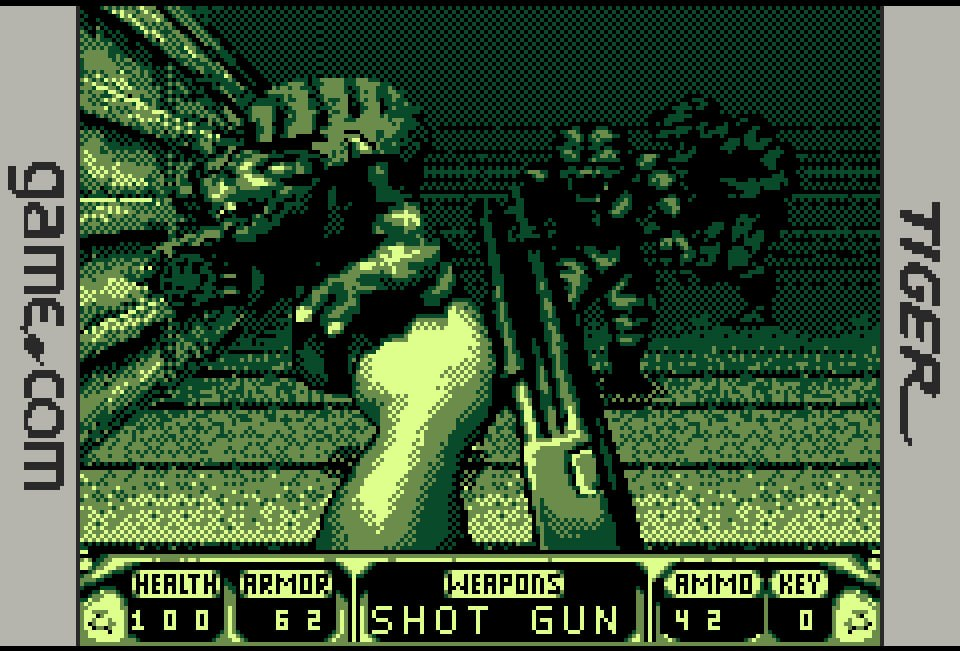

# gamecom2gba

Play Tiger game.com games on the Game Boy Advance.



gamecom2gba turns your own game.com cartridge dump into a native GBA ROM. You can open the resulting game in a GBA emulator or copy it to a flash cart for a real console. The original picture keeps its 200 × 160 size, framed by side panels in the colors of the game.com case.

No game data is included. You supply the ROM, and the converter checks that it is a supported cartridge before it does anything.

## Games

| Game | Status |
|---|---|
| **Duke Nukem 3D** | Playable, in development. Tested in mGBA and on real GBA hardware. → [How to play](docs/duke3d/duke-nukem-3d.md) |
| **Resident Evil 2** | Full campaign completed in mGBA. Physical GBA testing is pending. → [Port status and controls](docs/resident-evil-2/resident-evil-2.md) |
| Batman & Robin | Planned |
| Castlevania | Planned |
| Fighters Megamix | Planned |
| Indy 500 | Planned |
| Jurassic Park | Planned |
| Mortal Kombat Trilogy | Planned |
| Sonic Jam | Planned |

## Quick start

1. Get `gamecom2gba.exe` (Windows). To build it yourself, see the [development notes](docs/duke3d/duke-nukem-3d-development.md#build-the-converter-on-windows).
2. Run it with your cartridge dump. A ZIP or a raw ROM both work:

   ```powershell
   .\gamecom2gba.exe "Duke Nukem 3D (USA).zip"
   ```

3. The `.gba` files appear next to `gamecom2gba.exe`. Copy one to your flash cart or open it in an emulator.

For Resident Evil 2, pass your US cartridge dump to the same converter. It writes `resident-evil-2.gba` next to the executable. See the game guides for controls and tested routes.

## Documentation

- [Duke Nukem 3D: player guide](docs/duke3d/duke-nukem-3d.md)
- [Duke Nukem 3D: bonus maps and sounds on the original cartridge](docs/duke3d/duke-nukem-3d-original-assets.md)
- [Duke Nukem 3D: development notes](docs/duke3d/duke-nukem-3d-development.md): building, tests, rendering, and Ghidra research

## AI disclosure

This project is developed with the help of AI coding assistants, currently Anthropic's Claude and OpenAI's Codex. They are used for research, code, and documentation. A human maintainer directs the work, tests the results, and decides what gets merged.

## License

The project's code and documentation are released under the [MIT License](LICENSE). Game.com games, BIOS images, and their contents belong to their respective owners and are not part of this repository.
